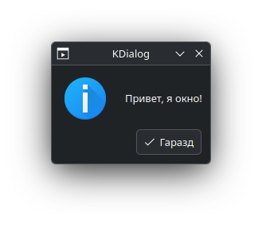

<div align="center">
    <h3>imp</h3>
</div>

`imp` это команда для импортирования другого файла **Kiwi** в ваш файл. Предназначено, как ни странно, для встраивания библиотек и других файлов **Kiwi** в файлы.

**Использование**: `imp` *[Полный путь к файлу]*
<br />
**Замены**: *пока не существует*

Пример:

```kiwi
imp libs/kdialog.kw

run msgbox Привет, я окно!
```

**Результат**:

<div align="center">
    
</div>